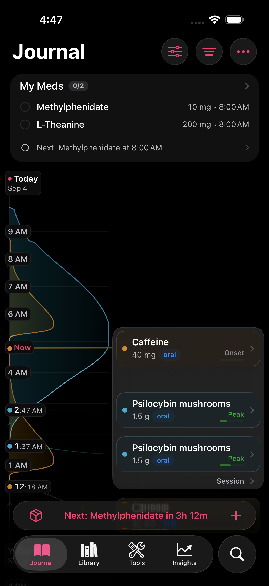
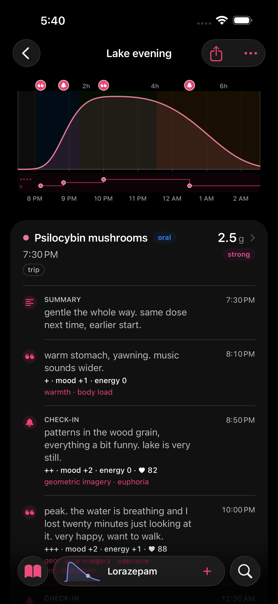

# Piru

Piru puts doses, timestamped notes and estimated drug-level curves on one timeline. Its offline substance reference shows where each field comes from and lets you choose which sources take priority.

<a href="https://kagerou.glass/get/piru/ios?from=readme"></a>
<a href="https://kagerou.glass/get/piru/mac?from=readme"></a>
<a href="https://kagerou.glass/get/piru/android?from=readme"></a>
<a href="https://discord.gg/hbpMZhPSdx"></a>

> Piru is not medical advice. Its models are estimates.

 

## Highlights

- Compare doses and session notes with estimated drug levels on one timeline.
- Import journals from PsychonautWiki Journal, DrugsPRO, and other apps that export in those formats.
- Official collaboration with [dose.wiki](https://dose.wiki/about), with its substance data available in the app.
- Inspect the sources behind each substance field and choose their priority.
- Keep the journal on your device, with exports and encrypted backups.

<details>
<summary>Full feature list</summary>

- Doses, tablet strengths, daily routines, and reminders.
- Timestamped session notes with mood, intensity, and effects.
- Offline substance reference, source comparison, and custom substances.
- Interaction checks and estimated drug-level curves.
- Medication calendar, supply tracking, and usage history.
- Record exports, session reports, and encrypted backups.
- Apple Health heart rate and blood pressure on iPhone, with permission.
- Apple Watch logging, Digital Crown dose entry, and complications.
- iPhone, Android, and Mac apps; [Android feature scope](android/README.md#scope).

</details>

## Automation

Two actions in the Shortcuts app and Siri, for any automation that already knows what was taken. **Log Dose** saves straight to the journal and answers with the entry's id. **Start Dose Log** opens the quick log with the dose staged, and nothing is saved until you tap Log. Both take a substance (a brand like *Concerta* stays on the dose as its product), and optionally an amount, unit, route, time, meal, notes and tags.

The same prefill works as a URL from any app, always for review:

```
piru://quicklog?substance=Concerta&amount=27&unit=mg&route=oral&time=2026-10-18T09:30:00Z&meal=empty&notes=late&tags=work
```

`time` is ISO 8601 or epoch seconds; `meal` is `empty`, `light` or `full`.

## Notes

- iOS/watchOS/macOS 26+; Android 9+ on 64-bit ARM. Mac supports Apple silicon and Intel. Apple Watch comes with the iPhone app.
- Android updates: add this repository to [Obtainium](https://github.com/ImranR98/Obtainium), filtering releases by `android-`.
- [Website](https://kagerou.glass/piru/) · [Bug reports](BUG-REPORTS.md) · [Contributing](CONTRIBUTING.md) · [简体中文](README.zh-Hans.md).

<details>
<summary>Credits and data sources</summary>

Piru’s name and capsule mascot come from its original author, [pharmacykitty](https://github.com/pharmacykitty). [kageroumado](https://github.com/kageroumado) continues the project.

The library draws on [substance.wiki](https://substance.wiki) and its
[SubFxOnEx](https://github.com/Di-lemma/SubFxOnEx) ontology (LGPL-2.1),
[PsychonautWiki](https://psychonautwiki.org) (CC BY-SA 4.0), [FreeOD Wiki](https://freeodwiki.org)
(CC BY-SA 4.0), [dose.wiki](https://dose.wiki) (CC0 1.0), [TripSit](https://tripsit.me),
[DailyMed](https://dailymed.nlm.nih.gov), [PubChem](https://pubchem.ncbi.nlm.nih.gov),
[Wikidata](https://www.wikidata.org), and the peer-reviewed literature cited in the app.

</details>
