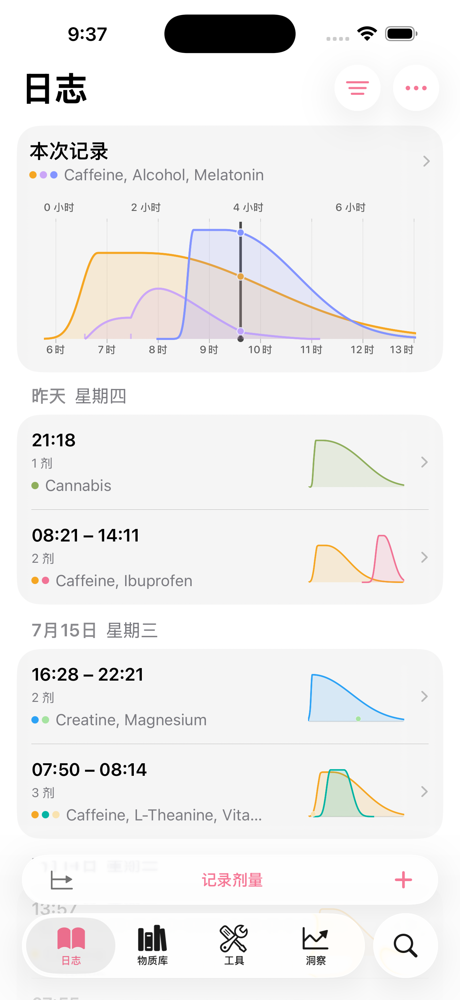
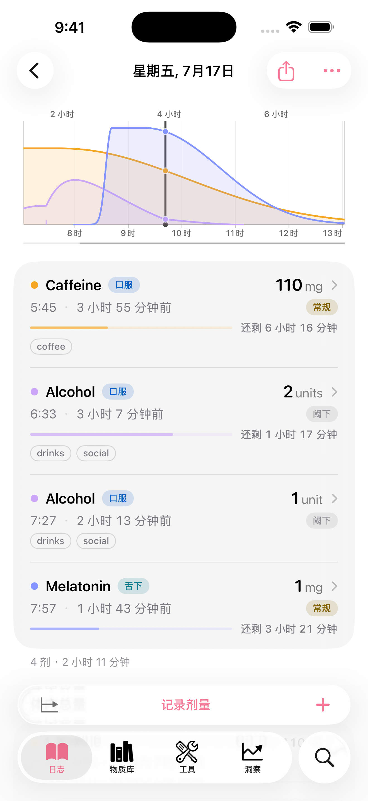

# Piru

Piru 将剂量、带时间戳的笔记和药物浓度估算曲线放在同一条时间线上。离线物质资料库逐项标明数据来源，并允许你调整来源的优先顺序。

> Piru 不是医疗建议。模型结果只是估算。

 

## 特色

- 在同一条时间线上对照剂量、会话笔记和药物浓度估算曲线。
- 从 PsychonautWiki Journal、DrugsPRO 及使用相同导出格式的其他应用导入日志。
- 与 [dose.wiki](https://dose.wiki/about) 正式合作，在应用内提供其物质数据。
- 查看物质数据的来源，并调整来源的优先顺序。
- 日志保存在你的设备上，可导出记录和加密备份。

完整功能

- 剂量、片剂规格、日常服药安排和提醒。
- 带时间戳、心情、强度和效应的会话笔记。
- 离线物质资料、来源对照和自定义物质。
- 相互作用检查和药物浓度估算曲线。
- 服药日历、库存和使用记录。
- 记录导出、会话报告和加密备份。
- iPhone 版经授权从 Apple 健康添加心率和血压。
- Apple Watch 剂量记录、数码表冠输入和表盘复杂功能。
- iPhone、Android 和 Mac 应用；[Android 功能范围](android/README.md#scope)。

## 其他信息

- iOS/watchOS/macOS 26+；Android 9+ 及 64 位 ARM。Mac 支持 Apple 芯片和 Intel；Apple Watch 版随 iPhone 版提供。
- Android 更新：将本仓库添加到 [Obtainium](https://github.com/ImranR98/Obtainium)，并按 `android-` 筛选发布版本。
- [网站](https://kagerou.glass/piru/) · [错误报告](BUG-REPORTS.md) · [参与开发](CONTRIBUTING.md) · [English](README.md)。

致谢与数据来源

Piru 的名字和胶囊吉祥物来自原作者 [pharmacykitty](https://github.com/pharmacykitty)，由 [kageroumado](https://github.com/kageroumado) 继续维护。

资料库使用了 [substance.wiki](https://substance.wiki) 及其
[SubFxOnEx](https://github.com/Di-lemma/SubFxOnEx) 本体（LGPL-2.1）、
[PsychonautWiki](https://psychonautwiki.org)（CC BY-SA 4.0）、[FreeOD Wiki](https://freeodwiki.org)
（CC BY-SA 4.0）、[dose.wiki](https://dose.wiki)（CC0 1.0）、[TripSit](https://tripsit.me)、
[DailyMed](https://dailymed.nlm.nih.gov)、[PubChem](https://pubchem.ncbi.nlm.nih.gov)、
[Wikidata](https://www.wikidata.org)，以及 app 中引用的同行评审文献。

