# Where the data goes

*Generated by `pipeline/audit/data_usage.py --graph`. Do not edit.*

Each populated table, the sources that fill it, and the screen it is
declared to belong on. **Red** means nothing renders it. **Amber** means
the app reads it and drops part of it before rendering.

```mermaid
graph LR
    subgraph sources[Sources]
    src_benzos_cited("benzos-cited")
    src_dosewiki("dosewiki")
    src_drug_community("drug.community")
    src_erowid_pihkal("erowid-pihkal")
    src_erowid_tihkal("erowid-tihkal")
    src_freeodwiki("freeodwiki")
    src_medtap("medtap")
    src_peer_review_primary("peer-review-primary")
    src_piru_curated("piru-curated")
    src_psychonautwiki("psychonautwiki")
    src_pyrls("pyrls")
    src_tripsit("tripsit")
    src_wikidata("wikidata")
    end
    product_codes["product_codes<br/>103,206 rows"]
    subjective_effects["subjective_effects<br/>23,653 rows"]
    coded_products["coded_products<br/>15,778 rows"]
    reported_effects["reported_effects<br/>12,022 rows"]
    durations["durations<br/>10,475 rows"]
    tags["tags<br/>7,077 rows"]
    aliases["aliases<br/>6,019 rows"]
    effects["effects<br/>2,952 rows"]
    citations["citations<br/>2,765 rows"]
    dose_ranges["dose_ranges<br/>2,731 rows"]
    substance_forms["substance_forms<br/>1,743 rows"]
    substances["substances<br/>1,680 rows"]
    localized_names["localized_names<br/>1,630 rows"]
    categories["categories<br/>1,583 rows"]
    bindings["bindings<br/>1,459 rows"]
    mechanisms_summary["mechanisms_summary<br/>1,232 rows"]
    subjective_effect_concept_aliases["subjective_effect_concept_aliases<br/>1,178 rows"]
    spectrum_levels["spectrum_levels<br/>972 rows"]
    molecule_shapes["molecule_shapes<br/>964 rows"]
    descriptions["descriptions<br/>946 rows"]
    substance_citations["substance_citations<br/>896 rows"]
    effect_vocab_labels["effect_vocab_labels<br/>789 rows"]
    drug_community_timelines["drug_community_timelines<br/>755 rows"]
    half_lives["half_lives<br/>707 rows"]
    substance_classes["substance_classes<br/>680 rows"]
    downstream_signalling["downstream_signalling<br/>677 rows"]
    metabolism["metabolism<br/>560 rows"]
    subjective_effect_concepts["subjective_effect_concepts<br/>506 rows"]
    pk_routes["pk_routes<br/>432 rows"]
    tag_enzyme_interactions["tag_enzyme_interactions<br/>285 rows"]
    class_citations["class_citations<br/>267 rows"]
    pharmacogenetics["pharmacogenetics<br/>246 rows"]
    substance_interaction_classes["substance_interaction_classes<br/>213 rows"]
    off_targets["off_targets<br/>209 rows"]
    drug_interactions_pk["drug_interactions_pk<br/>205 rows"]
    functional_assays["functional_assays<br/>178 rows"]
    interaction_rules["interaction_rules<br/>95 rows"]
    category_mechanisms["category_mechanisms<br/>92 rows"]
    neuroimaging["neuroimaging<br/>52 rows"]
    protocol_dosing["protocol_dosing<br/>52 rows"]
    class_contexts["class_contexts<br/>50 rows"]
    peptide_profiles["peptide_profiles<br/>44 rows"]
    class_reference_compounds["class_reference_compounds<br/>40 rows"]
    product_strengths["product_strengths<br/>33 rows"]
    diazepam_equivalents["diazepam_equivalents<br/>32 rows"]
    category_interaction_classes["category_interaction_classes<br/>29 rows"]
    concentration_effects["concentration_effects<br/>25 rows"]
    biased_agonism["biased_agonism<br/>23 rows"]
    durations_of_action["durations_of_action<br/>21 rows"]
    model_alias["model_alias<br/>18 rows"]
    sources["sources<br/>18 rows"]
    model_overrides["model_overrides<br/>17 rows"]
    taper_interventions["taper_interventions<br/>16 rows"]
    food_effects["food_effects<br/>15 rows"]
    product_durations["product_durations<br/>13 rows"]
    class_warning_citations["class_warning_citations<br/>12 rows"]
    enzyme_modulators["enzyme_modulators<br/>11 rows"]
    opioid_mme["opioid_mme<br/>11 rows"]
    substance_flags["substance_flags<br/>11 rows"]
    bioavailability_by_dose["bioavailability_by_dose<br/>10 rows"]
    withdrawal_acting_class["withdrawal_acting_class<br/>9 rows"]
    class_warning_exclusions["class_warning_exclusions<br/>8 rows"]
    ester_pk["ester_pk<br/>8 rows"]
    receptor_oligomers["receptor_oligomers<br/>8 rows"]
    saturable_kinetics["saturable_kinetics<br/>6 rows"]
    class_warnings["class_warnings<br/>5 rows"]
    regional_names["regional_names<br/>5 rows"]
    drink_presets["drink_presets<br/>4 rows"]
    withdrawal_timing_bands["withdrawal_timing_bands<br/>3 rows"]
    by_volume_dosing["by_volume_dosing<br/>2 rows"]
    category_mechanism_bindings["category_mechanism_bindings<br/>2 rows"]
    combination_metabolites["combination_metabolites<br/>2 rows"]
    attenuation_bands["attenuation_bands<br/>1 rows"]
    subgraph screen[On screen]
    ui_Discontinuation_Evidence(["Discontinuation Evidence"])
    ui_If_You_Stop(["If You Stop"])
    ui_chemistry(["chemistry"])
    ui_combinations(["combinations"])
    ui_doseDuration(["doseDuration"])
    ui_drugClass(["drugClass"])
    ui_effects(["effects"])
    ui_identity(["identity"])
    ui_mechanism(["mechanism"])
    ui_overview(["overview"])
    ui_pharmacokinetics(["pharmacokinetics"])
    ui_receptorLiterature(["receptorLiterature"])
    ui_sources(["sources"])
    end
    src_drug_community --> subjective_effects
    src_freeodwiki --> subjective_effects
    src_piru_curated --> subjective_effects
    subjective_effects --> ui_effects
    src_drug_community --> reported_effects
    reported_effects --> ui_effects
    src_dosewiki --> durations
    src_drug_community --> durations
    src_erowid_pihkal --> durations
    src_erowid_tihkal --> durations
    src_freeodwiki --> durations
    src_piru_curated --> durations
    src_psychonautwiki --> durations
    src_tripsit --> durations
    durations --> ui_doseDuration
    src_drug_community --> tags
    src_erowid_pihkal --> tags
    src_erowid_tihkal --> tags
    src_peer_review_primary --> tags
    src_piru_curated --> tags
    src_psychonautwiki --> tags
    src_pyrls --> tags
    src_tripsit --> tags
    src_wikidata --> tags
    tags --> ui_identity
    src_dosewiki --> aliases
    src_drug_community --> aliases
    src_erowid_pihkal --> aliases
    src_erowid_tihkal --> aliases
    src_freeodwiki --> aliases
    src_medtap --> aliases
    src_peer_review_primary --> aliases
    src_piru_curated --> aliases
    src_psychonautwiki --> aliases
    src_pyrls --> aliases
    src_tripsit --> aliases
    src_wikidata --> aliases
    aliases --> ui_identity
    src_piru_curated --> effects
    src_tripsit --> effects
    effects --> ui_effects
    citations --> ui_sources
    src_dosewiki --> dose_ranges
    src_drug_community --> dose_ranges
    src_erowid_pihkal --> dose_ranges
    src_erowid_tihkal --> dose_ranges
    src_freeodwiki --> dose_ranges
    src_piru_curated --> dose_ranges
    src_psychonautwiki --> dose_ranges
    src_tripsit --> dose_ranges
    dose_ranges --> ui_doseDuration
    substance_forms --> ui_identity
    substances --> ui_identity
    src_erowid_pihkal --> categories
    src_erowid_tihkal --> categories
    src_freeodwiki --> categories
    src_piru_curated --> categories
    src_psychonautwiki --> categories
    src_pyrls --> categories
    src_tripsit --> categories
    src_wikidata --> categories
    categories --> ui_identity
    src_dosewiki --> bindings
    src_peer_review_primary --> bindings
    src_piru_curated --> bindings
    bindings --> ui_receptorLiterature
    src_freeodwiki --> mechanisms_summary
    src_medtap --> mechanisms_summary
    src_piru_curated --> mechanisms_summary
    mechanisms_summary --> ui_mechanism
    src_drug_community --> spectrum_levels
    spectrum_levels --> ui_effects
    molecule_shapes --> ui_chemistry
    src_benzos_cited --> descriptions
    src_dosewiki --> descriptions
    src_freeodwiki --> descriptions
    src_piru_curated --> descriptions
    src_psychonautwiki --> descriptions
    descriptions --> ui_overview
    substance_citations --> ui_sources
    effect_vocab_labels --> ui_effects
    src_drug_community --> drug_community_timelines
    src_dosewiki --> half_lives
    src_medtap --> half_lives
    src_peer_review_primary --> half_lives
    src_piru_curated --> half_lives
    src_tripsit --> half_lives
    half_lives --> ui_pharmacokinetics
    substance_classes --> ui_drugClass
    src_peer_review_primary --> downstream_signalling
    downstream_signalling --> ui_mechanism
    src_peer_review_primary --> metabolism
    metabolism --> ui_pharmacokinetics
    src_benzos_cited --> pk_routes
    src_medtap --> pk_routes
    src_peer_review_primary --> pk_routes
    pk_routes --> ui_pharmacokinetics
    class_citations --> ui_sources
    src_peer_review_primary --> pharmacogenetics
    pharmacogenetics --> ui_pharmacokinetics
    src_piru_curated --> substance_interaction_classes
    substance_interaction_classes --> ui_combinations
    src_peer_review_primary --> off_targets
    off_targets --> ui_receptorLiterature
    src_peer_review_primary --> drug_interactions_pk
    drug_interactions_pk --> ui_combinations
    src_peer_review_primary --> functional_assays
    functional_assays --> ui_receptorLiterature
    src_piru_curated --> interaction_rules
    interaction_rules --> ui_combinations
    src_peer_review_primary --> neuroimaging
    neuroimaging --> ui_receptorLiterature
    src_piru_curated --> protocol_dosing
    protocol_dosing --> ui_doseDuration
    src_peer_review_primary --> class_contexts
    class_contexts --> ui_drugClass
    src_piru_curated --> peptide_profiles
    peptide_profiles --> ui_doseDuration
    class_reference_compounds --> ui_receptorLiterature
    product_strengths --> ui_doseDuration
    src_benzos_cited --> diazepam_equivalents
    diazepam_equivalents --> ui_doseDuration
    category_interaction_classes --> ui_combinations
    src_peer_review_primary --> concentration_effects
    concentration_effects --> ui_pharmacokinetics
    src_peer_review_primary --> biased_agonism
    biased_agonism --> ui_receptorLiterature
    src_piru_curated --> durations_of_action
    durations_of_action --> ui_doseDuration
    sources --> ui_sources
    src_piru_curated --> taper_interventions
    taper_interventions --> ui_Discontinuation_Evidence
    src_piru_curated --> food_effects
    food_effects --> ui_pharmacokinetics
    product_durations --> ui_doseDuration
    src_piru_curated --> enzyme_modulators
    enzyme_modulators --> ui_pharmacokinetics
    src_piru_curated --> opioid_mme
    opioid_mme --> ui_doseDuration
    src_piru_curated --> substance_flags
    substance_flags --> ui_mechanism
    src_piru_curated --> bioavailability_by_dose
    bioavailability_by_dose --> ui_pharmacokinetics
    src_piru_curated --> withdrawal_acting_class
    withdrawal_acting_class --> ui_If_You_Stop
    src_peer_review_primary --> receptor_oligomers
    receptor_oligomers --> ui_receptorLiterature
    src_piru_curated --> saturable_kinetics
    saturable_kinetics --> ui_pharmacokinetics
    src_piru_curated --> class_warnings
    src_piru_curated --> drink_presets
    drink_presets --> ui_doseDuration
    src_piru_curated --> withdrawal_timing_bands
    withdrawal_timing_bands --> ui_If_You_Stop
    src_piru_curated --> by_volume_dosing
    by_volume_dosing --> ui_doseDuration
    src_piru_curated --> combination_metabolites
    combination_metabolites --> ui_pharmacokinetics
    src_piru_curated --> attenuation_bands
    attenuation_bands --> ui_combinations
    classDef dead fill:#5b1a1a,stroke:#d06666,color:#fff;
    classDef partial fill:#5b451a,stroke:#d0a566,color:#fff;
    classDef live fill:#1a3d2b,stroke:#5fbf8f,color:#fff;
    class taper_interventions,withdrawal_acting_class,withdrawal_timing_bands dead;
    class product_codes,aliases,citations,dose_ranges,substance_forms,substances,localized_names,bindings,mechanisms_summary,subjective_effect_concept_aliases,spectrum_levels,descriptions,substance_citations,drug_community_timelines,half_lives,downstream_signalling,metabolism,subjective_effect_concepts,pk_routes,tag_enzyme_interactions,class_citations,pharmacogenetics,off_targets,drug_interactions_pk,functional_assays,interaction_rules,neuroimaging,protocol_dosing,class_contexts,peptide_profiles,product_strengths,diazepam_equivalents,concentration_effects,biased_agonism,durations_of_action,model_alias,sources,model_overrides,food_effects,product_durations,class_warning_citations,enzyme_modulators,opioid_mme,substance_flags,bioavailability_by_dose,class_warning_exclusions,ester_pk,receptor_oligomers,saturable_kinetics,regional_names,drink_presets,by_volume_dosing,combination_metabolites,attenuation_bands partial;
    class subjective_effects,coded_products,reported_effects,durations,tags,effects,categories,molecule_shapes,effect_vocab_labels,substance_classes,substance_interaction_classes,category_mechanisms,class_reference_compounds,category_interaction_classes,class_warnings,category_mechanism_bindings live;
```

## Declared a home, not yet rendered

| rows | table | belongs on | why it matters |
|---:|---|---|---|
| 16 | `taper_interventions` | Discontinuation Evidence | Tools > Tolerance > Discontinuation Evidence; verdict decides which half of the screen a row lands in, and the more useful half is the one that found no difference |
| 9 | `withdrawal_acting_class` | If You Stop | the clinical floor that keeps chlordiazepoxide in the long band its ~10 h parent half-life would miss; also the drugs each band names as its examples |
| 3 | `withdrawal_timing_bands` | If You Stop | the population onset/peak windows on Tools > Tolerance > If You Stop, and the half-life boundaries that pick which one a logged drug reads under |

## Not in the surface map

Add each to `pipeline/audit/data_surfaces.json` — a home, or `null`.

- `category_mechanism_bindings`
- `category_mechanisms`
- `class_warning_citations`
- `class_warning_exclusions`
- `class_warnings`
- `coded_products`
- `drug_community_timelines`
- `ester_pk`
- `localized_names`
- `model_alias`
- `model_overrides`
- `product_codes`
- `regional_names`
- `subjective_effect_concept_aliases`
- `subjective_effect_concepts`
- `tag_enzyme_interactions`
